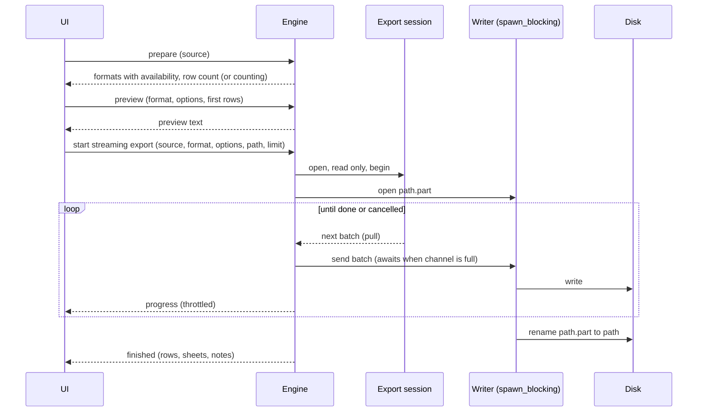
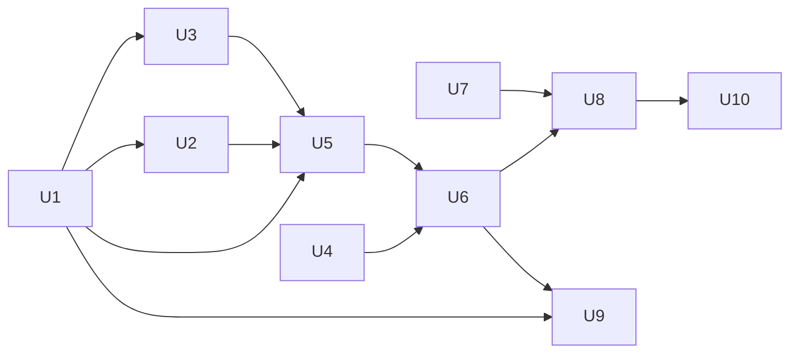

# feat: Export data to files (result export and streaming table export)

## Summary

A new `quarry-export` crate holds one writer per format. A writer knows nothing about databases: it takes columns, then batches of rows, and writes bytes. The engine gains an export module with two kinds of work. Small work previews and writes the rows already on the grid. Streaming work runs "Export all" and table exports on a dedicated session, pulls rows through a bounded channel to a blocking writer, and renames a `.part` file into place only when done. The UI adds the native save dialog, one export dialog, and two entry points: the result toolbar and the table context menu. Parquet ships in a second phase, after its bundle size is measured.

---

## Problem Frame

Users can only copy a selected block of cells to the clipboard. Nothing writes a file, nothing reaches Excel or Parquet, and the grid keeps at most 500 rows per result, so large tables and large joins have no way out. Full context: see origin `docs/brainstorms/2026-10-29-data-export-requirements.md`.

---

## Requirements

Requirement IDs trace to the origin document.

- R1-R6. Result export from the grid: toolbar entry, DataGrip-style formats (SQL Inserts, SQL Updates, Where Clause, Excel, CSV), no query run by default, row count with a choice of the first N rows, key-gated SQL Updates and Where Clause, preview for text formats.
- R7-R10. "Export all" for a cut result: runs the SQL again on its own connection, reads only, warns about session state and changed data, asks for a target table for SQL Inserts from a join.
- R11-R14. Table export from the tree context menu: wider formats (CSV, TSV, JSON, NDJSON, SQL Inserts, Excel, Parquet), total count and a row choice, follows the applied filter, consistent read.
- R15-R21. All exports: bounded memory with progress, cancel without a partial file, read-only in every environment, Excel sheet limit, exact numbers, minimal file options with an optional UTF-8 BOM, readable errors.

Plan-time additions confirmed in dialogue:

- R22. Excel splits into new sheets in the same file. The user can set the maximum rows per sheet; the default is the Excel limit.
- R23. When the expected row count passes about one million and the format is Excel, the dialog shows a non-blocking hint that Excel will open the file slowly and suggests CSV or Parquet.
- R24. No format has a cap on the total rows exported. A full disk fails with a clear error and leaves no partial file.
- R25. `DECIMAL` in Excel is a number when it has at most 15 significant digits, text otherwise. In Parquet it is a string.
- R26. The table total uses an exact count that runs in the background. The user can export before it finishes.

**Origin actors:** A1 (data analyst), A2 (backend developer), A3 (data engineer)
**Origin flows:** F1 (export the result on the grid), F2 (export all rows of a cut query), F3 (export a whole table)
**Origin acceptance examples:** AE1 (R3, R4), AE2 (R5), AE3 (R7, R8), AE4 (R9), AE5 (R16), AE6 (R14), AE7 (R18)

---

## Scope Boundaries

- Import, Copy Table to another connection, Dump to DDL, multi-table backups (see origin).
- Server-side export (`INTO OUTFILE`, `COPY`).
- A mode that writes the file during the first run of a query.
- Several result sets from one script in one export.
- Raising the grid row limit.
- Resuming a cancelled or broken export.
- Column selection, header renaming, per-column formatting.
- Changes to the clipboard copy actions.

### Deferred to Follow-Up Work

- Move clipboard CSV, TSV and JSON (`ui/src/lib/copy.ts`) onto the Rust writers so both paths share one implementation: separate refactor PR after this lands.
- Native Parquet `DECIMAL` (precision and scale from the column type): follow-up once Parquet ships.
- A capability flag for drivers that cannot give a consistent snapshot: when a second driver is added.

---

## Context & Research

### Relevant Code and Patterns

- `crates/driver-api/src/lib.rs`: `ExecOpts.row_limit` is already documented as "`None` = unlimited, for export only". `ExecSink` is a synchronous callback, so it cannot apply backpressure. `Dialect::select_page`, `count_rows`, `literal`, `quote_ident` and `qualify` build every SQL text export needs.
- `crates/engine/src/schema.rs` `insert_text`: dialect-built multi-row INSERT from client-sent rows. Its request/response pair (`Command::InsertSql` / `Event::InsertSql`) is the pattern for result export and preview.
- `crates/engine/src/query.rs`: `run_query` (sink to events), `single_statement`, `safety_check`, `count` / `count_rows`, `page_query` (builds a filtered table query from `BrowseQuery`).
- `crates/engine/src/connections.rs` `open_session`: opens a fresh session through the shared tunnel, which suits one dedicated session per export job.
- `crates/engine/src/metadata.rs` `meta_session` and `query.rs` `primary_key_on_tab`: where key lookup lives.
- `crates/engine/src/edit.rs` `key_filter`: the key choice rule for grid edits.
- `crates/model/src/column.rs` `ColumnMeta.source_database` / `source_table`: already decide whether a result is editable, so they also decide whether a result comes from one table.
- `crates/drivers/mysql/src/lib.rs`: per-result-set streaming with `row_limit`.
- `crates/store/src/lib.rs` `write_atomic`: the atomic write idea (temporary file, then rename), applied to a stream instead of a buffer.
- `ui/src/store/app.ts`: the `InsertSql` request map and reducer case; clipboard notice helper.
- `ui/src/features/grid/ResultGrid.tsx`, `ui/src/features/sidebar/ConnectionTree.tsx`, `ui/src/components/ui/Menu.tsx`: entry points and the menu primitive.

### Institutional Learnings

- No `docs/solutions/` in the repo yet.

### External References

- DBeaver data export: XLSX "Max row on sheet" continues on another sheet (https://github.com/dbeaver/dbeaver/wiki/Data-export).
- Beekeeper Studio: query downloads are capped like the grid, "Download full results" runs again, table exports stream (https://docs.beekeeperstudio.io/user_guide/data-export/).

---

## Key Technical Decisions

- **Pull-based row stream on `Session`.** The current sink is synchronous, so a full channel could only drop rows or block a tokio worker. Add a `Session` method that returns an async stream of `ExecItem` for one statement, with a default that answers `Unsupported`, and implement it for MySQL over the driver's row stream. The engine awaits a bounded channel send between batches, so a slow disk slows the database read instead of filling memory. The existing `execute` path is untouched.
- **Writers are synchronous and run in `spawn_blocking`.** File IO never runs on the runtime. The engine reads rows and sends batches. One blocking task receives them and writes to disk.
- **One writer contract, two sinks.** Each writer writes into any byte sink. Preview uses an in-memory buffer capped at the first rows. Files use the `.part` output. The preview therefore always matches the file.
- **`quarry-export` depends on `quarry-model` and `quarry-driver-api` only.** SQL writers need `Dialect`. Nothing in the crate does database IO, so it tests without a database.
- **One dedicated session per streaming job.** It is opened through `open_session`, set to read only, and holds one transaction. It never uses the tab session (that would lock the tab) or the metadata session (it would block introspection). It is closed when the job ends.
- **Consistent read is a read-only transaction.** With InnoDB's default isolation, the snapshot starts at the first read, so every row comes from one point in time. Tables without MVCC (MyISAM) give no such guarantee; this is documented, not detected.
- **Read-only gate reuses `quarry-sql`.** "Export all" accepts one statement classified as a read. A new pure helper in `quarry-sql` flags session-variable use (`@name`, not `@@name`) and temporary tables, outside strings and comments. It only warns; it never decides safety.
- **SQL Updates and Where Clause key on the primary key, else a unique NOT NULL key.** The grid edit fallback to every column is not used, since an UPDATE keyed on every column is rarely what the user wants. A single-column key gives an `IN` list. A composite key gives OR-ed groups. A NULL key value becomes `IS NULL`.
- **Excel writing uses a constant-memory mode**, so a million-row sheet does not sit in memory. Integers within 2^53 are numbers, larger ones are text. Decimals follow R25.
- **Progress events are throttled** (about four per second) so a fast export does not flood the channel the UI reads. Bytes are reported only for formats written straight to disk. Excel is compressed at finish, so its progress shows rows only.
- **Cancellation** sets a job flag, fires the export session's cancel handle, and makes the writer delete the `.part` file. Failure takes the same cleanup path.
- **The native save dialog only picks a path.** `tauri-plugin-dialog` returns a path to the UI, and the UI sends it to the engine. All disk writes stay in the engine, as the protocol rule requires. The engine checks that the parent folder exists and writes `<path>.part` beside the target, so the rename is atomic on the same file system.
- **Parquet is phase 2.** Arrow and Parquet add a large dependency tree. Phase 2 starts by measuring the release bundle size, with and without Parquet, and checking licenses in `deny.toml`.

---

## Open Questions

### Resolved During Planning

- Split Excel across sheets or files: sheets, with a user-set maximum (R22).
- Exact or estimated table count: exact, in the background, never blocking (R26). It runs on its own short-lived session, not the metadata session, and is cancelled when the dialog closes.
- How to keep memory flat with a synchronous sink: a pull-based stream on `Session` (see decisions).
- Where preview is built: in the engine, with the same writer as the file.
- How to tell whether a result comes from one table: every column shares one `source_database` and `source_table`, and the key columns of that table are all present in the result.

### Deferred to Implementation

- Writer crates and versions for Excel and Parquet: confirm constant-memory behavior and license against `deny.toml` when adding them.
- Batch size and channel capacity: start near 1,000 rows and 4 batches, then tune with the performance log.
- How to build an unbounded table query: extend `Dialect` with an export select that takes an optional limit, or reuse `select_page`. Decide after reading the MySQL dialect.
- Exact names of the new commands, events and types.

---

## Output Structure

    crates/export/
      Cargo.toml
      src/
        lib.rs          writer contract, format list, options, output (.part) handling
        delimited.rs    CSV and TSV
        json.rs         JSON array and NDJSON
        sql.rs          SQL Inserts, SQL Updates, Where Clause
        xlsx.rs         Excel
        parquet.rs      Parquet (phase 2)
    crates/engine/src/export.rs
    ui/src/features/export/
      ExportDialog.tsx
      ExportProgress.tsx

---

## High-Level Technical Design

> *This illustrates the intended approach and is directional guidance for review, not implementation specification. The implementing agent should treat it as context, not code to reproduce.*

Small exports (rows already on the grid) skip the session: the engine writes the rows the UI sent, in one blocking task.

| Source | Session | Row limit | Preview | Formats |
|---|---|---|---|---|
| Grid rows | none | rows on the grid, first N | text formats | Inserts, Updates, Where, Excel, CSV |
| Export all | dedicated, read only | none or N | first rows from the grid | same as grid rows |
| Table | dedicated, read only, one snapshot | none or N | first rows of a page | CSV, TSV, JSON, NDJSON, Inserts, Excel, Parquet |

---

## Phased Delivery

### Phase 1

U1 to U8 and U10: every format except Parquet, all three sources, the UI. The format list does not offer Parquet until U9 lands, so the table export dialog never shows a format that cannot run.

### Phase 2

U9: Parquet, gated on a bundle size check.

---

## Implementation Units

### U1. `quarry-export` crate: writer contract, delimited and JSON writers, safe output

**Goal:** A database-free crate that writes CSV, TSV, JSON and NDJSON from columns and row batches, with an output that never leaves a partial file.

**Requirements:** R15, R16, R19, R20, R24

**Dependencies:** None

**Files:**
- Create: `crates/export/Cargo.toml`, `crates/export/src/lib.rs`, `crates/export/src/delimited.rs`, `crates/export/src/json.rs`
- Modify: `Cargo.toml` (workspace member and `quarry-export` dependency), `deny.toml` (AGPL exception)
- Test: `#[cfg(test)] mod tests` in each new file

**Approach:**
- The contract has three steps: begin with the columns, write a batch, finish. Plus abort, which deletes the `.part` file.
- Options are one serializable type: format, delimiter, header row, BOM, maximum rows per sheet, target table.
- The output writes `<path>.part` through a buffered writer, flushes and syncs on finish, renames into place, and removes the `.part` file on abort or drop without finish.
- The format list declares, for each format, whether it has a preview, whether it needs a single source table and key, and its row limit per sheet. The UI reads this list and never matches format names.
- Value rendering follows `ui/src/lib/copy.ts`: NULL is empty in CSV and TSV and `null` in JSON. Integers beyond 2^53 are strings in JSON. Bytes are hex. Tabs and newlines inside TSV cells become spaces.
- IO errors map to a typed error (`thiserror`) carrying the path and kind, so the engine can say "folder not found", "permission denied" or "disk full".

**Patterns to follow:** `ui/src/lib/copy.ts` value rules, `crates/store/src/lib.rs` `write_atomic`, workspace lint settings.

**Test scenarios:**
- Happy path: three columns and two batches to CSV give a header row, CRLF lines, and fields quoted only when they contain a comma, quote, newline or edge spaces.
- Happy path: the BOM option writes the UTF-8 BOM first. Without it, the file starts with the header.
- Happy path: NDJSON writes one object per line with column names as keys. JSON writes one array.
- Edge case: zero rows give a header-only CSV and `[]` in JSON.
- Edge case: `Int(i64::MAX)` and `UInt(u64::MAX)` appear exactly in CSV and as strings in JSON. `Decimal("12345678901234567890.123")` keeps every digit.
- Edge case: a Vietnamese text value round-trips byte-for-byte.
- Error path: the parent folder does not exist, so begin fails with a "folder not found" kind and no file is created.
- Error path: abort after two batches removes the `.part` file and leaves no target file. A pre-existing target file stays untouched.
- Integration: finish renames `.part` to the target and the target holds every row.

**Verification:** `cargo test -p quarry-export` passes, clippy is clean, `cargo deny check` accepts the new crate.

---

### U2. SQL writers: Inserts, Updates, Where Clause

**Goal:** SQL text formats built through the connection's `Dialect`.

**Requirements:** R2, R5, R10, R12

**Dependencies:** U1

**Files:**
- Create: `crates/export/src/sql.rs`
- Test: `crates/export/src/sql.rs` (`mod tests`)

**Approach:**
- Inserts: multi-row INSERT statements in chunks (for example 500 rows per statement) so a huge export is not one statement, using `qualify`, `quote_ident` and `literal`.
- Updates: one UPDATE per row, setting every non-key column and keyed on the key columns.
- Where Clause: one `WHERE` clause. A single-column key gives an `IN` list, a composite key gives OR-ed AND groups, and NULL key values become `IS NULL`.
- The target table and key columns are inputs. The writer never decides them.

**Patterns to follow:** `crates/engine/src/schema.rs` `insert_text` and its test dialect `crate::edit::tests::Ansi`.

**Test scenarios:**
- Happy path: two rows to Inserts give one statement with quoted names and dialect literals, including `'it''s'` and `NULL`.
- Happy path: 1,200 rows with a chunk size of 500 give three statements.
- Happy path: Updates with key `id` give `UPDATE ... SET note = ... WHERE id = 1;` per row, and the key is not in `SET`.
- Happy path: Where Clause with a single key gives `WHERE id IN (1, 2, 3)`. A composite key gives `(a = 1 AND b = 'x') OR (...)`.
- Edge case: a NULL key value renders `IS NULL`, never `= NULL`.
- Error path: Updates without key columns fails with a reason ("needs a table with a primary key").

**Verification:** Unit tests pass against the ANSI test dialect.

---

### U3. Excel writer

**Goal:** Constant-memory XLSX with sheet splitting and exact numbers.

**Requirements:** R18, R19, R22, R25

**Dependencies:** U1

**Files:**
- Create: `crates/export/src/xlsx.rs`
- Modify: `crates/export/Cargo.toml`, `Cargo.toml` (workspace dependency)
- Test: `crates/export/src/xlsx.rs` (`mod tests`)

**Approach:**
- Use an XLSX library with a constant-memory (row-streaming) mode. Confirm the license against `deny.toml` before adding it.
- A new sheet starts when the current one reaches the maximum rows per sheet (default 1,048,575 data rows plus the header). Each sheet repeats the header.
- Numbers: Int and UInt within 2^53 and finite Float are numbers. Decimal is a number when it has at most 15 significant digits and parses exactly, text otherwise. Dates and timestamps are date cells with a format. Everything else is text.
- Finish reports the number of sheets written so the engine can tell the user (R18).

**Test scenarios:**
- Happy path: 10 rows give one sheet with a header and typed cells. Read the file back to check.
- Covers AE7. Edge case: a maximum of 3 rows per sheet with 7 rows gives three sheets (3, 3, 1), each with a header, and finish reports 3.
- Edge case: `Decimal("0.1")` is a number, and `Decimal("12345678901234567.89")` is text with every digit kept.
- Edge case: `UInt(u64::MAX)` is text.
- Integration: writing 200,000 rows keeps resident memory flat (checked with the performance log or a coarse allocation counter, not a strict assertion).

**Verification:** Tests pass. A generated file opens in Excel or LibreOffice with correct types (checked by hand once).

---

### U4. Session-state detector in `quarry-sql`

**Goal:** A pure helper that tells whether a statement likely depends on tab session state.

**Requirements:** R9

**Dependencies:** None

**Files:**
- Modify: `crates/sql/src/lib.rs` (or a new module beside the classifier)
- Test: same file, `mod tests`

**Approach:** Tokenize with the existing lexer, then flag user variables (`@name`, but not `@@name` and not `@` inside a string, a quoted identifier or a comment), `TEMPORARY`, and the references to temporary tables that a single statement can reveal. Never panic on huge or malformed input.

**Patterns to follow:** `classify` and its comment and string tests.

**Test scenarios:**
- Happy path: `SELECT * FROM t WHERE id = @x` is flagged. `SELECT @@version` is not.
- Edge case: `'@x'` in a string, `` `@x` `` as an identifier, and `-- @x` in a comment are not flagged.
- Edge case: an empty or unterminated statement returns not-flagged without panicking.

**Verification:** `cargo test -p quarry-sql` passes.

---

### U5. Engine protocol and small exports (grid rows, preview, prepare)

**Goal:** Commands and events for preparing an export, previewing it, and writing grid rows to a file.

**Requirements:** R1-R6, R17, R21, R23

**Dependencies:** U1, U2, U3

**Files:**
- Create: `crates/engine/src/export.rs`
- Modify: `crates/engine/src/command.rs`, `crates/engine/src/event.rs`, `crates/engine/src/dispatch.rs`, `crates/engine/src/lib.rs`, `crates/engine/Cargo.toml`, `crates/model/src/` (an export options and format type if they must cross the boundary)
- Regenerate: `ui/src/bindings/` through `just bindings` (never edited by hand)
- Test: `crates/engine/src/tests.rs`

**Approach:**
- **Prepare** (request id, source = grid rows with their columns, or a table with its `BrowseQuery`). It answers with every format of the source, each marked available or unavailable with a reason. Key availability comes from the source table's primary key on the metadata session. For a table it also returns the total row count when it arrives (R26), as a separate event.
- **Preview** (request id, format, options, columns, first rows): the writer writes into a buffer and the engine answers with text. A format without a preview answers unavailable. For a table source, prepare also returns the first rows of the filtered table (one small page through `page_query`), and the UI sends those rows back for preview, so every source previews the same way.
- **Write rows** (request id, connection, columns, rows, format, options, path): one blocking task writes, and the engine answers finished or failed. It follows the `InsertSql` pattern, so the rows the UI already holds are sent once.
- Errors go through one place that turns IO and driver errors into "what happened, what to do" text, with no raw driver output and no values in logs.
- No safety prompt: exports only read (R17).

**Patterns to follow:** `Command::InsertSql` / `Event::InsertSql`, `RequestId` pairs, `.claude/rules/protocol.md`.

**Test scenarios:**
- Happy path: write rows to CSV in a temp dir gives a finished event with the row count, and the file holds the rows.
- Covers AE1. Happy path: write rows with 500 rows and N = 100 writes 100 rows and runs no statement on any session.
- Covers AE2. Happy path: prepare on columns from two source tables marks SQL Updates and Where Clause unavailable with a reason, and CSV and SQL Inserts available.
- Happy path: preview of SQL Inserts returns the same text as the file for the same rows.
- Error path: write rows to a missing folder gives a failed event naming the folder and suggesting another, and no file.
- Error path: preview for Excel answers that the format has no preview.

**Verification:** Engine unit tests pass without a database (temp config dir, `disable_keyring: true`). `just bindings` output is committed.

---

### U6. Streaming exports: "Export all" and table export

**Goal:** Unbounded, cancellable, consistent exports with progress.

**Requirements:** R7-R9, R11-R16, R24, R26

**Dependencies:** U4, U5

**Files:**
- Modify: `crates/driver-api/src/lib.rs` (pull-based stream method on `Session`, default `Unsupported`), `crates/drivers/mysql/src/lib.rs` (implementation), `crates/engine/src/export.rs`, `crates/engine/src/command.rs`, `crates/engine/src/event.rs`, `crates/engine/src/dispatch.rs`, possibly `crates/driver-api/src/lib.rs` `Dialect` (unbounded table select)
- Test: `crates/engine/src/tests.rs`, `crates/engine/src/mysql_tests.rs`, `crates/drivers/mysql/src/lib.rs` tests

**Approach:**
- **Export all** (request id, connection, database, SQL, format, options, path, optional limit): refuse unless the SQL is one statement classified as a read. Prepare reports the session-state warning from U4.
- **Table export** (request id, connection, table, `BrowseQuery`, format, options, path, optional limit): the engine builds the query through the dialect, with filter values as parameters.
- **Job:** open a dedicated session, set it read only, begin. Pull items from the stream. Send each batch to the writer over a bounded channel and await when it is full. Emit throttled progress (rows, bytes). Finish, then commit, close the session, and emit finished with rows, sheets and notes.
- **Cancel export** (request id): set the job flag, fire the session's cancel handle, abort the writer. Emit failed with `cancelled: true`.
- **Count:** for a table source, prepare starts an exact count on its own short-lived session and emits it when done. It never uses the metadata session, so a slow count on a huge table cannot block the tree or completion. Closing the dialog, or starting the export, cancels the count through that session's cancel handle and closes the session. The count never blocks the export.
- A driver without the stream method answers a readable "cannot export all rows yet".

**Technical design:** *(directional)* The engine loop is: next item from the session stream, then send a batch to the writer channel (awaiting), then check the cancel flag, then throttle progress. The writer task owns the file and the format writer, and finishes or aborts when the channel closes.

**Patterns to follow:** `run_query` (events, perf marks, lost-connection handling), `open_session`, the cancel handle kept apart from the busy session, `count_rows`.

**Test scenarios:**
- Covers AE3. Error path: Export all with `UPDATE t SET a = 1` is refused with a reason and opens no session.
- Covers AE4. Happy path: prepare for `SELECT * FROM t WHERE x = @total` includes the session-state warning.
- Covers AE5. Integration (MySQL): cancel a table export mid-stream gives a cancelled event, kills the server query, and leaves no `.part` or target file.
- Integration (MySQL): closing the dialog while the count runs cancels it, and loading the tree on the same connection is not delayed by the count.
- Covers AE6. Integration (MySQL): rows inserted into the table after the export starts are absent from the file.
- Integration (MySQL): Export all of a 3-table JOIN returning more rows than the grid limit writes every row.
- Integration (MySQL): table export with a filter writes only matching rows, and the count matches.
- Edge case: a limit of N stops after exactly N rows and closes the session cleanly.
- Error path: the connection drops mid-export, so the export fails with a readable error, the `.part` file is removed, and nothing is retried.
- Happy path (unit, no database): progress events are throttled. A stub stream of many small batches produces at most a few events per second.

**Execution note:** Start with a failing MySQL integration test for cancel-leaves-no-file. It pins the cleanup contract that every format depends on.

**Verification:** Unit tests pass without Docker. `just test-db` passes with `QUARRY_TEST_MYSQL` set. Say so explicitly if it could not run.

---

### U7. Native save dialog

**Goal:** The UI can ask the user for a save path.

**Requirements:** F1, F2, F3 (choose a file)

**Dependencies:** None

**Files:**
- Modify: `src-tauri/Cargo.toml`, `Cargo.toml` (workspace dependency), `src-tauri/src/lib.rs` (register the plugin), `src-tauri/capabilities/default.json` (save permission only), `package.json` (JS plugin)
- Create: a thin wrapper in `ui/src/lib/` so components never call the plugin directly

**Approach:** Allow only the save dialog, not open or file system access. The suggested file name is `<table or "result">.<ext>`. Native overwrite confirmation comes from the OS dialog.

**Test scenarios:** Test expectation: none -- plugin wiring and a permission. Checked by hand in `just dev`.

**Verification:** The dialog opens on macOS and Linux and returns a path. No other dialog permission is granted.

---

### U8. Export UI

**Goal:** One dialog and progress surface for all three flows, plus both entry points.

**Requirements:** R1, R4, R6, R7, R9, R11, R13, R16, R20, R22, R23, R26; F1-F3

**Dependencies:** U5, U6, U7

**Files:**
- Create: `ui/src/features/export/ExportDialog.tsx`, `ui/src/features/export/ExportProgress.tsx`
- Modify: `ui/src/store/app.ts` (actions, request maps, reducer cases), `ui/src/features/grid/ResultGrid.tsx` (toolbar entry), `ui/src/features/sidebar/ConnectionTree.tsx` (Import/Export submenu with an export entry), `ui/src/components/ui/` (a primitive only if one is missing)

**Approach:**
- The dialog shows: format select from prepare's list (unavailable ones disabled with their reason), row count and an N field (default all), options for the chosen format, preview pane for text formats, the "Export all" choice when the result was cut with its warning, the Excel hint over about one million rows, and a target table field for SQL Inserts without a single source.
- Progress is a non-blocking notice with rows, size and a Cancel button. Finish shows rows, sheets and a "Show in folder" action if one is available without new disk access in the UI. Otherwise it just shows the path.
- Engine calls happen only in store actions. Values format through `lib/values.ts`. No SQL classification in TypeScript.
- Memoize so typing in the N field does not re-render the grid.

**Test scenarios:** Test expectation: none -- there is no UI test runner. Check by hand per `.claude/rules/ui.md`: light and dark, narrow window, the three flows, cancel, a disabled format reason, and the Excel hint.

**Verification:** `pnpm check` passes. Manual checks are listed in the PR.

---

### U9. Parquet writer (phase 2)

**Goal:** Parquet for table export and Export all, with bounded memory.

**Requirements:** R12, R15, R25

**Dependencies:** U1, U6

**Files:**
- Create: `crates/export/src/parquet.rs`
- Modify: `crates/export/Cargo.toml`, `Cargo.toml`, `deny.toml` if licenses need it
- Test: `crates/export/src/parquet.rs` (`mod tests`)

**Approach:**
- First measure the release bundle size with and without the dependency, and record it in the PR. Stop and discuss if the increase is unacceptable.
- The schema comes from the first batch: each column's type is the first non-NULL `Value` variant. All-NULL columns become strings. Decimal is a string. A later value of another variant converts to text if the column is a string column, otherwise the export fails with a clear error.
- Row groups are flushed at a fixed row count so memory stays bounded.

**Test scenarios:**
- Happy path: int, text, timestamp and decimal columns round-trip through a Parquet reader with expected types and values.
- Edge case: a column that is NULL in the first batch and int later becomes a string column, and values are kept.
- Edge case: zero rows give a valid file with a schema.
- Error path: a type conflict in a typed column fails with a message naming the column.

**Verification:** Tests pass. A file reads in DuckDB or pandas (checked by hand once). Bundle size is recorded.

---

### U10. Documentation

**Goal:** Docs describe the new crate and the export runtime.

**Requirements:** Project doc rules (one home per fact)

**Dependencies:** U8

**Files:**
- Modify: `docs/ARCHITECTURE.md` (crate table, dependency line, a short Runtime entry on export jobs), `README.md` (crate table)

**Approach:** Follow the PR checklist in `CONTRIBUTING.md`. `CHANGELOG.md` is handled as that checklist says. Do not edit it if it is generated.

**Test scenarios:** Test expectation: none -- documentation.

**Verification:** Links resolve, and no counts or timings that will drift.

---

## System-Wide Impact

- **Interaction graph:** new commands in dispatch, new events reduced in `store/app.ts`, a new `Session` method with a default, and a new menu on the tree and the grid.
- **Error propagation:** IO and driver errors become one user-facing text in the engine, delivered by a failed event. Writers return typed errors.
- **State lifecycle risks:** a `.part` file left behind by a crash of the whole app. It is removed on the next export to the same path, and the final file is never partial.
- **API surface parity:** the headless core keeps exports available to a future CLI or MCP client with no UI logic involved.
- **Integration coverage:** cancel, consistency and lost connection need the MySQL integration tests in U6.
- **Unchanged invariants:** `RUN_ROW_LIMIT` and the tab query path are untouched. Bounded results still hold for the grid. Safe mode is not involved because exports only read. No SQL is built in the UI.

---

## Risks & Dependencies

| Risk | Mitigation |
|------|------------|
| Parquet bloats the bundle | Phase 2 with a measured size gate |
| An XLSX library buffers whole sheets | Choose one with a constant-memory mode, verify with 200k rows |
| A pull stream does not fit the MySQL driver's API | Spike in U6 first. The fallback is a bounded handoff inside the driver without blocking the runtime |
| A long read-only transaction holds undo history on a busy server | Documented. Cancel ends it at once. The user sees progress |
| New dependency licenses | `cargo deny check` in each unit that adds one |
| In a Flatpak, the save dialog goes through the document portal, which exposes only the chosen file: the `<name>.part` file beside it cannot be created | Check in a Flatpak build before release. If it fails, write the target directly when `.part` is refused, or ask the Flatpak for a wider `--filesystem` |

---

## Documentation / Operational Notes

- Record bundle size before and after U3 and U9 in their PRs.
- With `QUARRY_PERF`, export jobs log duration, rows and batch counts only, never values.

---

## Sources & References

- **Origin document:** [docs/brainstorms/2026-10-29-data-export-requirements.md](docs/brainstorms/2026-10-29-data-export-requirements.md)
- Related code: `crates/driver-api/src/lib.rs`, `crates/engine/src/query.rs`, `crates/engine/src/schema.rs`, `crates/engine/src/connections.rs`, `ui/src/lib/copy.ts`
- External docs: https://github.com/dbeaver/dbeaver/wiki/Data-export, https://docs.beekeeperstudio.io/user_guide/data-export/
